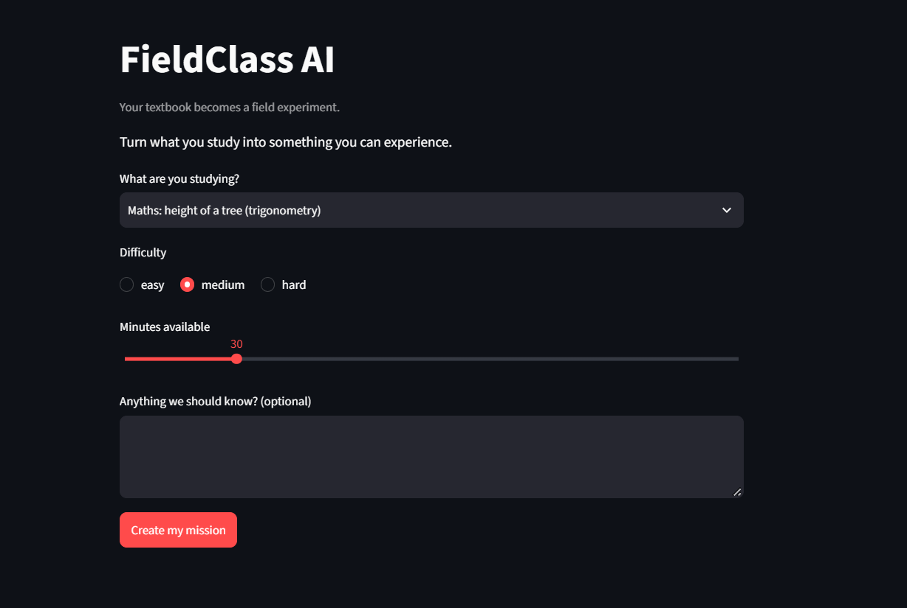
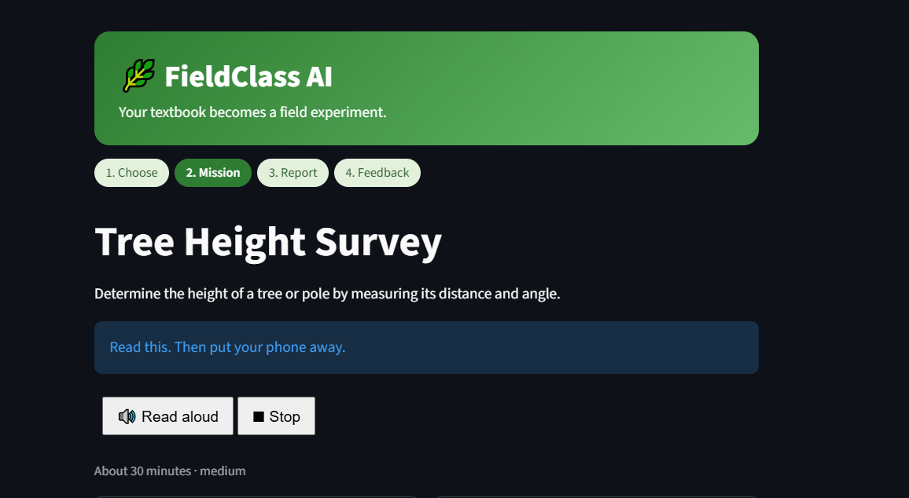
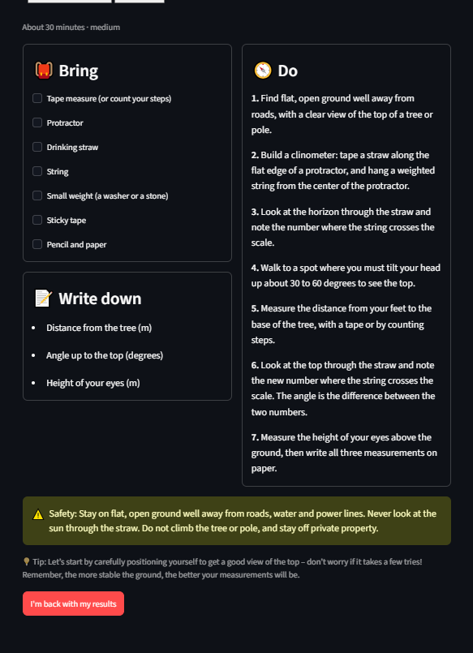
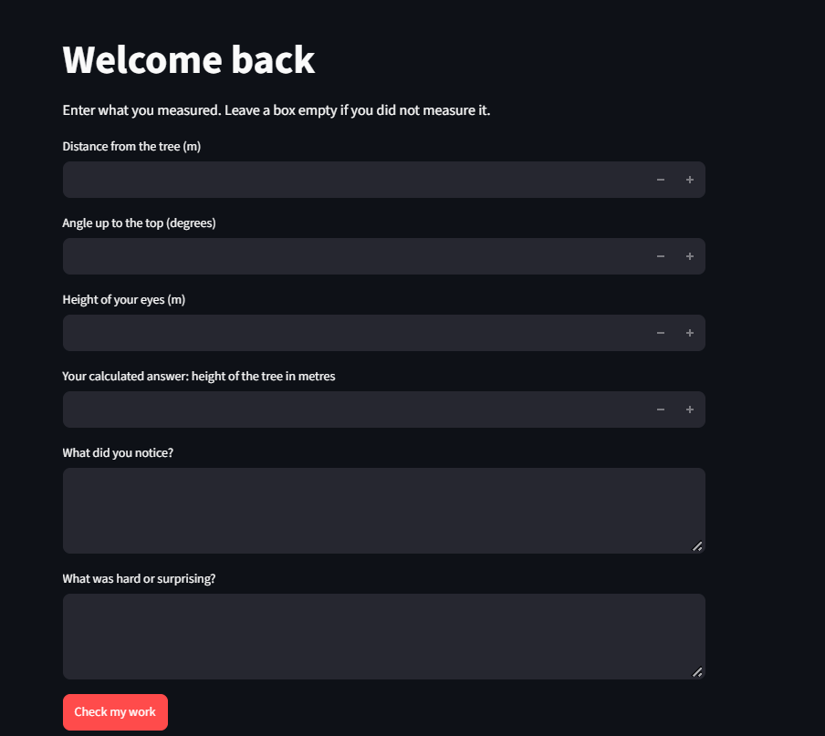
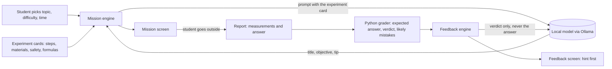

# FieldClass AI

> **Your textbook becomes a field experiment.**

FieldClass AI turns a topic you are studying into a short outdoor experiment, then helps you make sense of what you found when you come back. It runs on a small open-weight model on your own machine, so nothing you type leaves your computer.

Most AI study tools add screen time. FieldClass does the opposite: it hands you a mission you can read in under a minute, gets out of the way while you go outside and measure something real, and then checks your work when you return.

Built for the Hacktoberfest 2026 Open-Source AI Challenge, Week 1, theme **Touch Grass**.









## What it does

1. Choose a topic, a difficulty and how many minutes you have.
2. FieldClass writes a short field mission: what to bring, what to do, what to write down, and a safety note.
3. Put your phone away and carry out the mission outdoors.
4. Come back and enter your measurements and your own calculated answer.
5. FieldClass checks your answer against your own measurements, tells you what went well, and gives a hint before it shows any answer.

The four starting topics:

| Topic | Outdoor experiment |
|---|---|
| Trigonometry | Estimate the height of a tree or pole with a homemade clinometer |
| Statistics | Count and classify objects in a 1 m square to find frequencies |
| Plant morphology | Measure and compare two fallen leaves |
| Average velocity | Time a friend walking a measured path |

## How it works



### The design decision that mattered most

Early tests with the small model (Gemma 3 1B) showed it could write fluent text but got facts wrong: it invented physics ("the angle of the sunlight"), dropped the eye height from the formula, cut sentences in half, and praised students for things they never did.

So the model does not own any facts. Each experiment is a vetted card written by a person, and Python does everything that has a right answer:

| Python owns | The model writes |
|---|---|
| Materials, steps, what to record, the safety note, the concept | A title, a one-sentence objective, a short tip |
| The expected answer, the verdict, the likely mistake, the hint | One next-challenge sentence |

Everything the model writes is checked before the student sees it: no numbers, no forbidden words (traffic, climbing, and other unsafe ideas), and a retry if the check fails. The model is never told the correct answer, so it cannot leak it, even if a student asks it to.

## Why an open-weight model

- **Local and private.** The model runs through [Ollama](https://ollama.com) on the student's own computer. Notes and measurements never go to a third-party server.
- **Swappable.** The model is chosen by a named profile in `fieldclass/config.py`. Moving to a larger model is one new profile, not a code change. See [docs/SWAP.md](docs/SWAP.md).
- **No API key, no cost per mission.**
- **Inspectable.** Because the model is small and local, we could test it hard, find exactly where it fails, and design around that.

## Measured on a modest laptop

These come from my own runs on an Intel i5-6300U with 8 GB of RAM and no usable GPU. They are not a benchmark.

- Generation speed: about 16 tokens per second
- A mission: about 9 to 20 seconds
- Feedback: about 5 to 10 seconds

## Known limitations

- The 1B model sometimes glues words together ("degreesto") and writes generic tips.
- It does not reliably use the student's optional notes.
- Only the four topics above are supported.
- Grading checks the student's calculation against their own measurements. It cannot know the real height of the tree.

## Setup

You need Python 3.13, Git and [Ollama](https://ollama.com). In PowerShell:

```
git clone https://github.com/mukul9116/fieldclass-ai
cd fieldclass-ai
python -m venv .venv
.venv\Scripts\Activate.ps1
pip install -r requirements.txt
ollama pull gemma3:1b
```

Make sure Ollama is running, then start the app:

```
streamlit run app.py
```

### Model profiles

The active profile is chosen by the `FIELDCLASS_PROFILE` environment variable. If it is not set, the `lite` profile (`gemma3:1b`) is used. To check:

```
python -c "from fieldclass.config import get_profile; print(get_profile())"
```

## Tests

```
python -m pytest
```

The tests cover the grader, the schemas, the safety checks and the prompt builders. They do not need the model.

## Project layout

```
app.py                  Streamlit app
fieldclass/
  config.py             model profiles
  llm.py                the only module that talks to Ollama
  schemas.py            request, mission, report and feedback forms
  experiments.py        the four experiment cards and calculators
  prompts.py            prompt builders
  safety.py             checks on model-written text
  mission.py            mission engine
  grading.py            expected answers, verdicts, likely mistakes
  feedback.py           feedback engine
prompts/                system prompts as text files
tests/                  pytest tests
docs/                   MVP scope and model-swap checklist
```

## License

The code is released under the MIT License (see [LICENSE](LICENSE)). Model weights are not included in this repository and are subject to their own terms.

## Future work

- Run the same code on a larger Gemma model on a GPU machine and compare, using the swap checklist.
- Proof mode: let the student add a photo of their measurement setup.
- More experiment cards.
